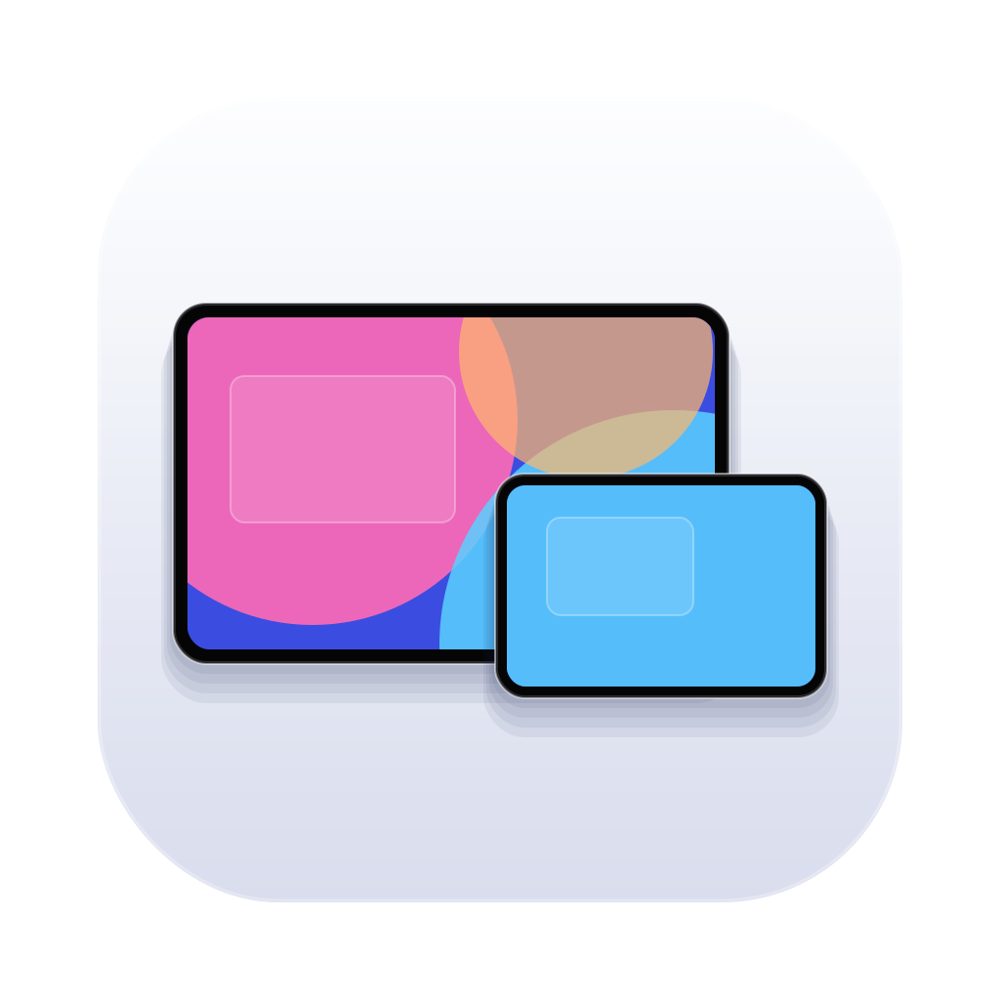
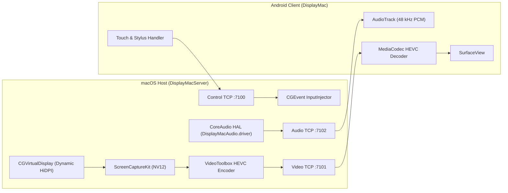

<div align="center">



# DisplayMac

### Low-Latency Wired & Wireless macOS Virtual Display for Android Tablets

Native `ScreenCaptureKit` + `VideoToolbox` HEVC Streaming • USB-C (`adb reverse`) & Wi-Fi (Bonjour) • Dynamic HiDPI Virtual Display • Pressure-Sensitive Stylus & Multi-Touch

<p align="center">
  <a href="https://github.com/aniketlab/DisplayMac/releases/latest"></a>
  <a href="https://github.com/aniketlab/DisplayMac/actions/workflows/ci.yml"></a>
  <a href="LICENSE"></a>
  <a href="https://www.apple.com/macos/"></a>
  <a href="https://www.android.com/"></a>
</p>

</div>

---

## Overview

**DisplayMac** turns an Android tablet into a secondary or headless primary display for macOS with zero cloud servers and zero subscriptions. It spawns a dynamically matched HiDPI `CGVirtualDisplay` only while an Android client is connected, captures frames via `ScreenCaptureKit`, hardware-encodes HEVC via `VideoToolbox`, and renders on Android using low-latency `MediaCodec` + `SurfaceView`.

### Key Capabilities
- **Adaptive Resolution & Refresh Rate:** Client handshakes the tablet's real physical display resolution, DPI, and maximum refresh rate (60–120 Hz+), spawning a matching virtual display with proportional HiDPI Retina scale modes.
- **USB-C & Wi-Fi Transport:** Connect over a direct `adb reverse` TCP tunnel (`60 Mbps`) or local Wi-Fi via automatic Bonjour discovery (`35 Mbps`).
- **48 kHz Stereo Audio Routing:** Installs an isolated CoreAudio HAL driver (`DisplayMacAudio.driver`) that surfaces the connected tablet in the macOS Sound menu and restores your previous output device on disconnect.
- **Multi-Touch & Stylus Input:** Translates normalized touch gestures (tap, double-tap, right-click, kinetic scroll, double-tap drag, pinch-zoom) and stylus pressure/tilt/hover events into macOS `CGEvent` input.
- **On-Demand Display Isolation:** Virtual displays spawn on connection and tear down cleanly when stopped—never hijacking physical monitors.

---

## Architecture



---

## Quick Start

### 1. macOS Host Installation

```bash
git clone https://github.com/aniketlab/DisplayMac.git
cd DisplayMac
./install.sh
```
*(Or double-click **`Install DisplayMac.command`** in Finder. Use `./install.sh --usb-only` to restrict listening sockets strictly to `127.0.0.1`.)*

The installer compiles the universal CoreAudio HAL driver, installs standalone Google `adb` if needed, builds `DisplayMacServer` in release mode, and activates the `com.displaymac.server` LaunchAgent.

### 2. Install the Android App

Download the latest signed APK from [**GitHub Releases**](https://github.com/aniketlab/DisplayMac/releases/latest) and install it on your Android device (Android 8.0+ / API 26+).

Or build from source:

```bash
cd android-client
./gradlew testDebugUnitTest assembleDebug
./gradlew installDebug
```
On Windows, use `gradlew.bat assembleDebug` or `scripts\deploy_android.bat`. To build a signed release APK locally (`assembleRelease`), configure `android-client/keystore.properties` (see [docs/setup_guide.md](docs/setup_guide.md)).

### 3. Connect
- **Wired (USB-C):** Enable **USB Debugging** on your tablet, connect via USB-C, and tap **Connect with USB-C**.
- **Wireless (Wi-Fi):** Connect both devices to the same Wi-Fi network; Bonjour discovers your Mac automatically, then tap **Connect over Wi-Fi** (or use **Enter IP manually**).

---

## Repository Structure

```text
DisplayMac/
├── .github/workflows/ci.yml        # Android + macOS CI builds & unit tests
├── macos-server/
│   ├── Package.swift               # SwiftPM manifest (DisplayMacProtocol + DisplayMacServer)
│   ├── Sources/
│   │   ├── DisplayMacProtocol/     # Shared wire codecs & packet validation
│   │   └── DisplayMacServer/       # Capture, VideoToolbox, Network, Input, Audio, VirtualDisplay
│   ├── Tests/DisplayMacProtocolTests/
│   ├── Driver/DisplayMacAudio.c    # CoreAudio HAL driver (BlackHole-derived, GPL-3.0)
│   ├── setup_dynamic_audio.sh      # Universal clang driver builder
│   └── setup_usb.sh                # Manual ADB reverse forwarding helper
├── android-client/
│   ├── app/src/main/               # Kotlin client + adaptive layouts (compact & w600dp)
│   ├── app/src/test/               # JUnit unit tests (ProtocolConstants, DeviceProfile)
│   ├── gradlew / gradlew.bat       # Cross-platform Gradle wrapper
│   └── build.gradle.kts
├── shared/protocol.md              # Binary wire protocol specification (v1.0)
├── docs/setup_guide.md             # Setup, headless Mac & gesture guide
├── scripts/                        # USB forwarding & Windows ADB deployment scripts
├── install.sh / Install DisplayMac.command
├── stop_server.sh
├── uninstall.sh / Uninstall DisplayMac.command
├── LICENSE                         # MIT (original code) + GPL-3.0 scope note
└── THIRD_PARTY_NOTICES.md          # Open-source attributions
```

---

## Server Management

| Action | Command |
| :--- | :--- |
| Stop background service & clear ADB tunnels | `./stop_server.sh` |
| Start / Stop via LaunchAgent | `macos-server/start.sh` / `macos-server/stop.sh` |
| Full uninstall (binary, driver, plist, DisplayMac TCC entries) | `./uninstall.sh` or `Uninstall DisplayMac.command` |

*(See [docs/setup_guide.md](docs/setup_guide.md) for headless boot setup and advanced configuration.)*

---

## Security & Privacy Notes

- **Zero Telemetry / Cloud:** All video, audio, and input stays strictly between your tablet and Mac over USB-C loopback or your local network.
- **No Built-In Pairing Token on LAN:** By default, Wi-Fi mode listens on local network interfaces so Bonjour discovery works seamlessly. On untrusted networks, run with `--usb-only` (`./install.sh --usb-only`) to bind exclusively to `127.0.0.1` for USB-C tunneling.

---

## License & Third-Party Notices

- Original DisplayMac source code (`macos-server/Sources/`, `android-client/`, installer scripts, and documentation) is licensed under the **MIT License** — see [LICENSE](LICENSE).
- `macos-server/Driver/DisplayMacAudio.c` is derived from Existential Audio Inc.’s **BlackHole** and remains governed by **GPL-3.0** — see [THIRD_PARTY_NOTICES.md](THIRD_PARTY_NOTICES.md).
