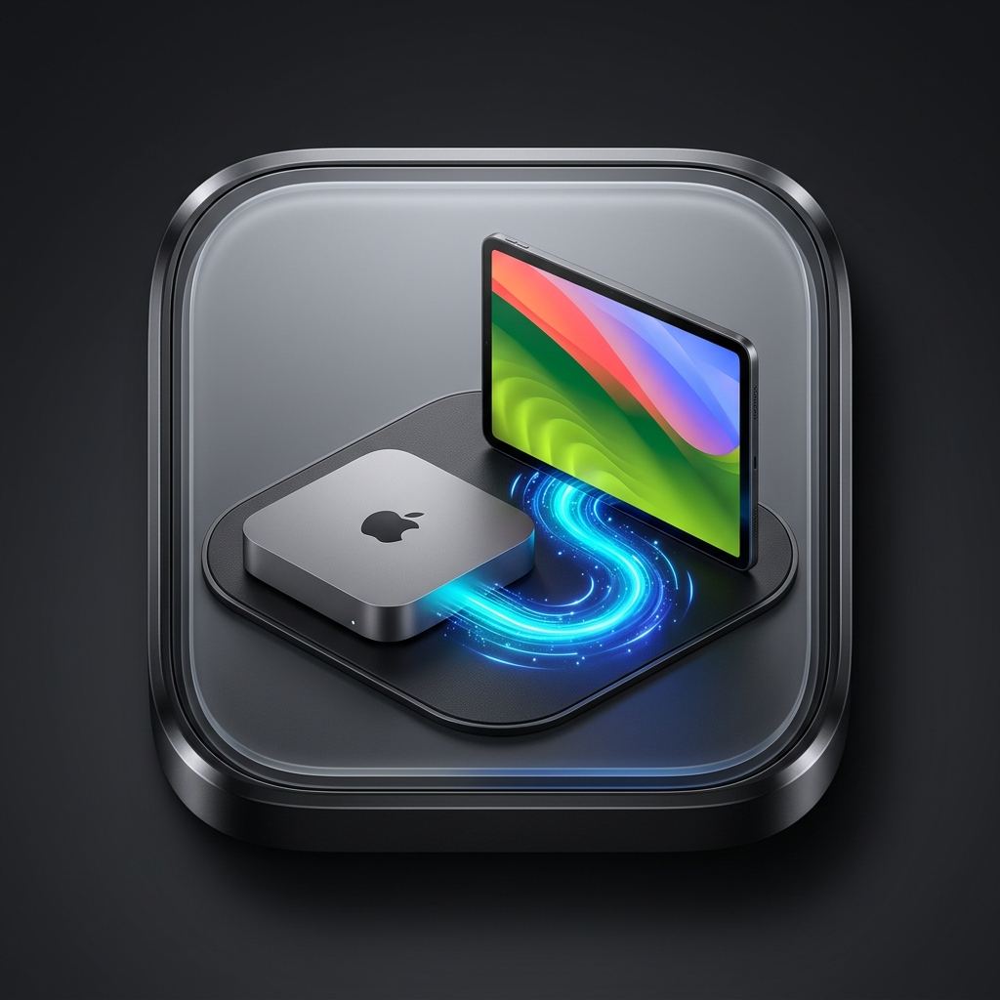
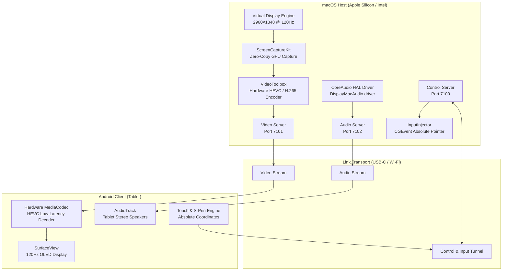

<p align="center">
  
</p>

# DisplayMac ⚡🖥️

<p align="center">
  <strong>Transform your Android Tablet into an Ultra-Low-Latency, 120Hz ProMotion Secondary Display for macOS.</strong><br>
  <em>Native Apple Silicon Hardware Acceleration • Direct 5 Gbps USB-C & Wi-Fi • Absolute Pointer & S-Pen Navigation • 100% Free & Open Source</em>
</p>

<p align="center">
  <a href="https://opensource.org/licenses/MIT"></a>
  <a href="https://www.apple.com/macos/"></a>
  <a href="https://www.android.com/"></a>
  <a href="#"></a>
  <a href="#"></a>
  <a href="#"></a>
</p>

---

## 📖 Table of Contents

- [Why DisplayMac?](#-why-displaymac)
- [Key Features](#-key-features)
- [Architecture & Data Pipeline](#-architecture--data-pipeline)
- [Device & Hardware Compatibility](#-device--hardware-compatibility)
- [Quick Start Guide](#-quick-start-guide)
  - [1. macOS Host Server Setup](#1-macos-host-server-setup)
  - [2. Android Tablet Setup](#2-android-tablet-setup)
  - [3. Connecting (USB-C & Wi-Fi)](#3-connecting-usb-c--wi-fi)
- [Audio Subsystem & Smart Fallback](#-audio-subsystem--smart-fallback)
- [Touch & S-Pen Input (Absolute Pointer)](#-touch--s-pen-input-absolute-pointer)
- [Repository Structure](#-repository-structure)
- [Troubleshooting & Reset](#-troubleshooting--reset)
- [Credits & Acknowledgements](#-credits--acknowledgements)
- [License](#-license)

---

## 💡 Why DisplayMac?

Apple’s official **Sidecar** is restricted solely to iPads, leaving Android tablets like the **Samsung Galaxy Tab S10 / S9 / S8 Ultra** unsupported. Third-party alternatives (like Duet Display or Spacedesk) often require monthly subscriptions, introduce lag, or fail to support native 16:10 OLED aspect ratios at 120 FPS.

**DisplayMac** delivers a completely free, local, open-source solution:
1. **Calibrated for 16:10 OLED**: Native `2960×1848` physical backing store with a comfortable 2.0x Retina scale (`1480×924` HiDPI points) for razor-sharp text and zero letterboxing.
2. **Apple Silicon Hardware Acceleration**: Captures display frames with zero-copy using `ScreenCaptureKit` and encodes via `VideoToolbox` hardware HEVC (H.265).
3. **Bypasses MacBook Air Display Limits**: MacBook Air (M1/M2/M3) hardware natively limits external monitors to just **one**. DisplayMac creates a virtual display in software, allowing MacBook Air users to add a second display anywhere.
4. **100% Local & Wire-Speed**: Runs directly over USB-C (5 Gbps) or local Wi-Fi with zero internet dependency, zero accounts, and zero cloud streaming.

---

## 🌟 Key Features

- **⚡ 120 FPS ProMotion Stream**: Buttery-smooth rendering designed for 120Hz OLED panels with sub-millisecond wire latency over USB-C.
- **🖥️ True HiDPI Retina Scaling**: Crisp, native macOS desktop rendering with no blurriness or distortion.
- **🔌 Plug-and-Play USB-C Link**: Automated ADB reverse port forwarding (ports 7100, 7101, 7102) over direct USB wire.
- **📡 Wireless Wi-Fi Option**: Automatic mDNS / Bonjour network discovery for cable-free usage on 5GHz/6GHz Wi-Fi networks.
- **🔊 Dynamic Audio with Memory Fallback**:
  - Routes Mac audio to tablet speakers using a native CoreAudio HAL driver.
  - Automatically restores sound to your physical Mac Mini / BenQ monitor speakers when the tablet disconnects.
- **🖱️ Absolute Pointer & Stylus Navigation**:
  - Touch and S-Pen map directly to absolute screen coordinates.
  - S-Pen hover tracking and side button right-click support.
- **🛡️ Safe & Isolated Operation**: The virtual display spawns only when the tablet is actively connected. Your primary physical monitor is never hijacked.

---

## 🏗️ Architecture & Data Pipeline



---

## 💻 Device & Hardware Compatibility

### Supported Mac Hardware
- **MacBook Air** (M1, M2, M3) — *Bypasses Apple's single-external-monitor hardware limit!*
- **MacBook Pro** (M1, M2, M3, M4 / Pro / Max)
- **Mac mini** (M1, M2, M4)
- **iMac** (M1, M3, M4)
- **Mac Studio & Mac Pro** (M1, M2, M3 Max / Ultra)
- **Intel Macs** running macOS 14.0+ (Sonoma or Sequoia)

### Supported Android Tablets
- **Samsung Galaxy Tab Series**: S10 Ultra, S10+, S9 Ultra, S9+, S8 Ultra, S8+, S7+ (120Hz OLED displays).
- **Other Android Tablets**: Xiaomi Pad, Lenovo Tab, OnePlus Pad, or any tablet running Android 10.0+ with hardware HEVC decoding.

---

## 🚀 Quick Start Guide

### 1. macOS Host Server Setup

On your Mac, clone the repository and run the master installer:

- **Via Finder (Easiest)**: Simply double-click **`Install DisplayMac.command`**.
- **Via Terminal**:
  ```bash
  git clone https://github.com/aniketlab/DisplayMac.git
  cd DisplayMac
  ./install.sh
  ```

This single command automatically:
1. Compiles and installs the native CoreAudio driver (`DisplayMacAudio.driver`).
2. Configures the Google standalone ADB bridge for zero-lag USB-C transfer.
3. Compiles `DisplayMacServer` in optimized Release mode.
4. Registers and activates the 24/7 background LaunchAgent daemon (`com.displaymac.server`).
5. Sets up your Mac Mini to run headlessly without any physical monitor attached!

---

### 2. Android Tablet Setup

#### Option A: Direct APK Install (Fastest)
The repository contains a pre-built APK:
```bash
adb install -r DisplayMac.apk
```
*(Or copy `DisplayMac.apk` to your tablet and install via Samsung My Files).*

#### Option B: Build from Source
```bash
cd android-client
./gradlew assembleDebug
./gradlew installDebug
```

---

### 3. Connecting (USB-C & Wi-Fi)

- **Wired (USB-C — Recommended)**:
  1. Connect a USB-C 3.2 cable between your Mac and tablet.
  2. Open the **DisplayMac** app on your tablet and tap **Connect via USB-C**.
  3. The display will launch immediately at 120 FPS.
- **Wireless (Wi-Fi)**:
  1. Ensure both devices are on the same Wi-Fi router (5GHz recommended).
  2. Launch DisplayMac on the tablet. The app auto-discovers your Mac’s local IP via Bonjour.
  3. Tap **Connect via Wi-Fi**.

---

## 🔊 Audio Subsystem & Smart Fallback

DisplayMac uses a lightweight CoreAudio HAL driver (`DisplayMacAudio.driver`) compiled natively on your Mac via `./setup_dynamic_audio.sh`.

```
[Mac System Audio] 
       │
       ▼ (Select "DisplayMac Audio" in Sound Menu)
[DisplayMac Server] ──────► [Tablet AKG Speakers]
       │
       ▼ (Tablet unplugged or disconnected)
[Smart Audio Guardian] ──► Automatically restores sound to:
                           • BenQ / External Monitor
                           • Mac mini Built-in Speakers
                           • Headphones
```

- **No Audio Hijacking**: Connecting the tablet does not force your sound away from your desk monitor.
- **Manual Routing**: Select **DisplayMac Audio** in the macOS menu bar volume menu when you want sound on your tablet.
- **Hardware Fallback**: When the tablet is unplugged, audio automatically switches back to your physical monitor or speakers without getting stuck in silence.

---

## 🖱️ Touch & S-Pen Input (Absolute Pointer)

Because macOS is fundamentally architected around a pointer/cursor coordinate system, DisplayMac translates touch and S-Pen interactions directly into absolute macOS pointer events (`CGEvent`):

| Input Method | Tablet Action | macOS Result |
| :--- | :--- | :--- |
| **Finger Tap** | Tap on screen | Left-click at target location (cursor moves to tap point) |
| **Finger Drag** | Touch and move | Left-click drag (window dragging, slider adjustments) |
| **S-Pen Tip** | Touch & draw | Cursor navigation and primary click/drag |
| **S-Pen Side Button** | Hold button + tap | Right-click (Context Menu) |
| **S-Pen Hover** | Pen held near screen | Moves cursor pointer under pen nib |

---

## 📁 Repository Structure

```
DisplayMac/
├── macos-server/                    # Native macOS Swift Server
│   ├── Sources/
│   │   ├── VirtualDisplay/          # Virtual display generation (CoreGraphics)
│   │   ├── Capture/                 # ScreenCaptureKit zero-copy frame stream
│   │   ├── Encoder/                 # VideoToolbox hardware HEVC encoder
│   │   ├── Network/                 # TCP socket server & Bonjour discovery
│   │   ├── Common/                  # CoreAudio manager & protocol types
│   │   ├── Input/                   # CGEvent absolute pointer injection
│   │   └── main.swift               # Server coordinator & lifecycle
│   ├── Driver/                      # Native CoreAudio HAL C driver source
│   ├── setup_dynamic_audio.sh       # Compiles & registers audio driver
│   └── setup_usb.sh                 # ADB reverse tunnel port-forwarding
├── android-client/                  # Android Kotlin Application
│   ├── app/src/main/java/com/displaymac/client/
│   │   ├── decoder/                 # Low-latency MediaCodec HEVC decoder
│   │   ├── display/                 # 120Hz SurfaceView controller
│   │   ├── input/                   # S-Pen & touch coordinate forwarder
│   │   └── network/                 # ConnectionManager & Bonjour client
│   └── build.gradle.kts
├── shared/                          # Wire protocol specification (protocol.md)
├── install.sh                       # Master installer (Audio + USB + Server + Service)
├── Install DisplayMac.command       # Double-clickable macOS master installer
├── uninstall.sh                     # Complete uninstaller (Drivers + Service + TCC reset)
├── Uninstall DisplayMac.command     # Double-clickable macOS uninstaller
├── stop_server.sh                   # Stop running server & reset hardware audio
├── DisplayMac.apk                   # Pre-compiled ready-to-use Android APK
├── LICENSE                          # MIT Open Source License
└── README.md                        # Documentation
```

---

## 🛠️ Server Management (Install & Uninstall)

### 1. Master Installation (One-Click Setup)
To install the native dynamic audio driver, USB-C bridge, and configure the 24/7 background headless daemon:

- **Via Finder**: Simply double-click **`Install DisplayMac.command`**.
- **Via Terminal**:
  ```bash
  ./install.sh
  ```

This automatically:
1. Compiles and installs the native CoreAudio HAL driver (`DisplayMacAudio.driver`).
2. Configures the Google standalone ADB bridge (`/usr/local/bin/adb`).
3. Compiles `DisplayMacServer` in release mode and installs it to `/usr/local/bin/DisplayMacServer`.
4. Sets up the persistent macOS `LaunchAgent` daemon (`com.displaymac.server.plist`) with `KeepAlive: true` and `RunAtLoad: true`.
5. Ensures DisplayMac **auto-starts upon Mac boot, login, or reboot**, and stays alive after sleep.
6. Engages sleep-prevention assertions so your Mac mini will never sleep in the middle of a streaming session.
7. Turns your Galaxy Tab into the **primary display** even when NO physical monitor is plugged into the Mac mini!

#### 📌 Essential Headless Mac Mini Setup (Booting Without a Monitor)
Because a headless Mac Mini has no physical monitor to type a password at the initial startup login window:
1. **Disable FileVault** (if enabled): Go to **System Settings > Privacy & Security > FileVault** and turn it **Off** (macOS disk encryption prevents any application or network driver from launching before login).
2. **Enable Automatic Login**: Go to **System Settings > Users & Groups**, and set **"Automatically log in as"** to your user account.
3. *Security Tip*: Once Automatic Login is enabled, DisplayMac will connect to your Galaxy Tab right after power on. You can lock your screen anytime and type your password securely from your tablet!

---

### 2. Smart Auto-Reconnect Watchdog (Zero-Click Recovery)
The Android client features an active auto-reconnection watchdog:
- **On App Launch**: DisplayMac automatically begins searching for your Mac over USB-C. Just plug the cable and open the app—no buttons required.
- **Cable Jiggle / Disconnect**: If the USB cable is unplugged or sleep occurs, the app does not crash or give up. It enters auto-reconnect mode and retries every 1.5 seconds. Re-plugging the cable resumes the 120 FPS desktop in under a second!

---

### 3. Stopping the Server (Temporary Reset)
To temporarily stop the server, pause the background service, release virtual displays, and restore physical Mac audio without deleting files:
```bash
./stop_server.sh
```

---

### 4. Complete Uninstallation (Factory Clean)
If you connected a physical monitor and want to permanently purge DisplayMac, its audio drivers, background services, and privacy permissions from macOS:

- **Via Finder**: Simply double-click **`Uninstall DisplayMac.command`**.
- **Via Terminal**:
  ```bash
  ./uninstall.sh
  ```

This completely:
1. Kills all running DisplayMac instances.
2. Removes all LaunchAgent autostart configurations.
3. Uninstalls `/Library/Audio/Plug-Ins/HAL/DisplayMacAudio.driver`.
4. Restarts `coreaudiod` to restore 100% stock factory macOS audio.
5. Clears all ADB socket tunnels and runtime temporary locks.
6. Revokes **Screen Recording**, **Accessibility**, and **Input Monitoring** privacy permissions for Terminal and DisplayMac.
7. Leaves your Mac in a pristine, untouched factory-clean state.

---

## 🤝 Credits & Acknowledgements

DisplayMac relies on established low-latency streaming and media technologies:

- **Apple Developer Platforms**: For `ScreenCaptureKit`, `VideoToolbox`, and CoreAudio APIs.
- **Android Open Source Project (AOSP)**: For `MediaCodec` hardware decoding and `SurfaceView`.
- **Google Android Platform Tools**: For `adb` reverse port-forwarding over USB wire.
- **[Genymobile / scrcpy](https://github.com/Genymobile/scrcpy)**: Inspiration for reverse-tunnel USB data communication.
- **[Moonlight](https://github.com/moonlight-stream) & [Sunshine](https://github.com/LizardByte/Sunshine)**: Research in low-latency video streaming pipelines.

---

## 📄 License

DisplayMac is distributed under the **MIT License**. See [LICENSE](LICENSE) for full details.

```
Copyright (c) 2026 Aniket Sharma
```

<p align="center">
  <b>Built with ❤️ for power users pairing Android OLED tablets with Apple Silicon.</b>
</p>
